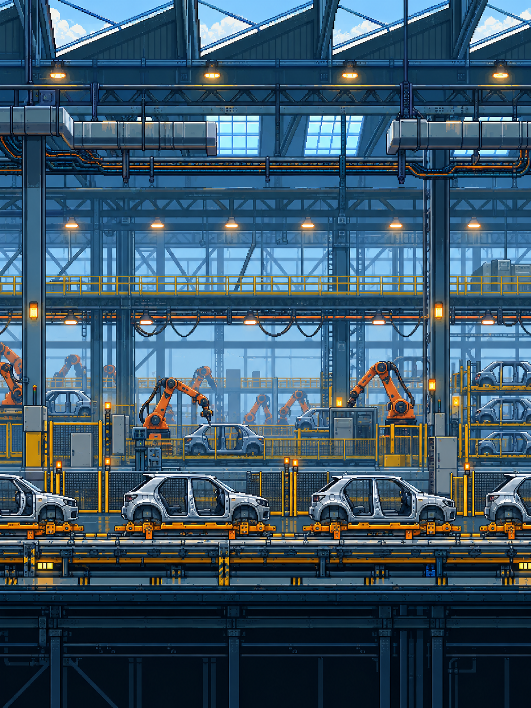

<div align="center">


# Anão de Firma

**A firma não para. Você também não.**

Um arcade Android em pixel art dentro de uma fábrica de automóveis.

[**Baixar para Android**](https://github.com/walmirramos/Anao/raw/refs/heads/main/docs/downloads/AnaoDeFirma-1.2.apk)

Android 5.0+ · Português · Dubbox 2026
</div>

## Entre na linha de montagem

Um novo protagonista, uma nova identidade e seis setores industriais: estampagem, soldagem, pintura, montagem, qualidade e expedição. Carrocerias, robôs de solda, esteiras e estruturas metálicas compõem a fábrica inspirada na Stellantis.

Desvie de dutos, colunas e máquinas com faixas de segurança. Some peças, supere seu recorde e aproveite os poderes temporários.

## Ouça a fábrica

Trilha chiptune industrial original, motores, transportadores, sinais eletrônicos e impactos metálicos. Música e máquinas têm controles de volume separados.

## Como jogar

Toque na tela para impulsionar o personagem. Evite os obstáculos e o chão. Os bônus de pneu, parafusadeira e bazuca continuam disponíveis, com efeitos de dez segundos. Nas configurações, personalize a experiência e as cores do personagem.

## Instalação

Baixe o APK acima e abra no Android. Autorize a instalação pelo aplicativo usado no download quando solicitado. Esta edição tem identificador próprio e pode ser instalada junto com outros jogos.

## Desenvolvimento

Projeto Android Java. JDK 17 ou 21, Android SDK 35.

```powershell
./gradlew.bat :app:assembleDebug
```

- `app/`: jogo, arte e áudio.
- `docs/`: apresentação e APK.
- `scripts/`: geração do áudio e verificações.
- [Identidade e sons](guides/INDUSTRIAL.md).
- [Licenças](LICENSE.md).



## Novidades da versão 1.1

- Fundo detalhado no estilo 16 bits, com carros e robôs de montagem.
- Bônus a partir de 3 coins: pneu protetor, parafusadeira para ampliar o vão e bazuca com explosão, fumaça e destroços. Efeitos de 10 segundos.
- Splash de moedas a cada obstáculo ultrapassado.
- A partir de 20 coins, carteira de trabalho coletável: +10 coins e coroa pelo restante da partida.
- Logo ilustrada somente na abertura e no carregamento inicial. Menu sem efeitos de bônus.
- Novos sons de motores, ferramentas e ar comprimido; queda com um fail cômico original.

## Versão 1.2

Protagonista original fornecido, sem regeneração. Abertura e loading limpos, somente logo e textos. Carros móveis com sprite detalhado no estilo 16 bits e acabamentos dos obstáculos corrigidos.

Aos 30 coins, os obstáculos oscilam suavemente, mantendo o vão e parando durante a travessia. Aos 40, começa o turno macabro com iluminação sombria e uma ambientação sonora original provisória. O áudio exato do meme depende da identificação da referência.
