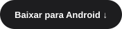

<div align="center">


# Corre Nengue.

### A polícia vem aí.

São Paulo em pixels. Personalidade em cada partida.<br>
Um toque para entrar no corre. Só mais uma vez para tentar superar seu recorde.

<br>

<a href="https://walmirramos.github.io/CorreNengue/"></a>
&nbsp;
<a href="https://walmirramos.github.io/CorreNengue/downloads/CorreNengue-1.10.1.apk"></a>

<br><br>

**Android 5.0+** &nbsp; · &nbsp; **Versão 1.10.1** &nbsp; · &nbsp; **Dubbox 2026**

</div>

<br>

## A cidade não para.

O Corre Nengue leva a correria para uma São Paulo em pixel art: prédios, paredes de
tijolos, céu poluído e cenários que mudam conforme você avança. Nas fases mais
adiante, o lixão pega fogo e a paisagem ganha ainda mais personalidade.

Toque para ganhar impulso, atravesse as passagens e acumule **Nencoins**.
Seu próximo objetivo é simples: passar do próprio recorde.

## Dez segundos. Outra partida.

Colete os bônus no caminho e mude o ritmo da correria.

| Bônus | O que acontece | Duração |
| :--- | :--- | :---: |
| **Banana · Sayajin** | Aura dourada e proteção contra paredes. | 10 s |
| **Celular** | Amplia o vão entre as paredes para dar mais espaço. | 10 s |
| **Bazuca** | Dispara automaticamente, explode paredes e espalha tijolos. | 10 s |

A primeira banana aparece a partir de **20 Nencoins**. Depois entram os outros
itens e novas aparições variam durante a partida. A pausa congela os efeitos.
O chão continua sendo um obstáculo.

## Seu Nengue. Seu estilo.

**Clássico, azul ou rosa.** Escolha uma paleta ou deixe o jogo sortear.
Os menus estão em português, e as configurações permitem ajustar o ritmo,
os cenários e os efeitos da partida.

Música chiptune, sirene e efeitos em 8 bits completam a identidade do jogo.
Música e sirene têm controles de volume separados.

## Comece o corre.

1. [Baixe o APK 1.10.1](https://walmirramos.github.io/CorreNengue/downloads/CorreNengue-1.10.1.apk) no seu Android.
2. Abra o arquivo e conclua a instalação. Se solicitado, permita a instalação pelo aplicativo que abriu o APK.
3. Toque em **Nengue Play** e depois na tela para começar.

O download tem aproximadamente **18,6 MB**. O arquivo de
[verificação SHA-256](docs/downloads/CorreNengue-1.10.1.sha256) acompanha o APK.

<details>
<summary><strong>Uma dica para explorar as configurações.</strong></summary>

Para ativar a invencibilidade, desenhe um **L** com um dedo: desça e depois siga
para a direita, sem levantar o dedo entre as partes. Solte ao terminar.

Faça o gesto no centro da tela, longe das bordas de navegação do Android.
Ele funciona no menu, nas Configurações e durante a partida. A confirmação
**Invencibilidade ativada** aparece na tela. Repita o L para desativar.

</details>

## Por dentro do projeto.

```text
app/         Aplicativo Android e recursos do jogo
docs/        Site oficial, artes de apresentação e download
guides/      Compilação, controles e identidade visual
scripts/     Verificações da lógica do jogo
legal/       Termos e avisos dos componentes
```

Com o **JDK 21** e o **Android SDK 35** configurados:

```powershell
.\gradlew.bat :app:assembleDebug
```

O APK é gerado em `app/build/outputs/apk/debug/app-debug.apk`.

[Guia Android](guides/ANDROID.md) &nbsp; · &nbsp;
[Identidade visual](guides/ART.md) &nbsp; · &nbsp;
[Notas de versão](CHANGELOG.md) &nbsp; · &nbsp;
[Como contribuir](CONTRIBUTING.md) &nbsp; · &nbsp;
[Site e hospedagem](docs/README.md) &nbsp; · &nbsp;
[Termos](LICENSE.md)

<br>

<div align="center">

**Dubbox 2026.**<br>
São Paulo em pixels. O corre é seu.

</div>
